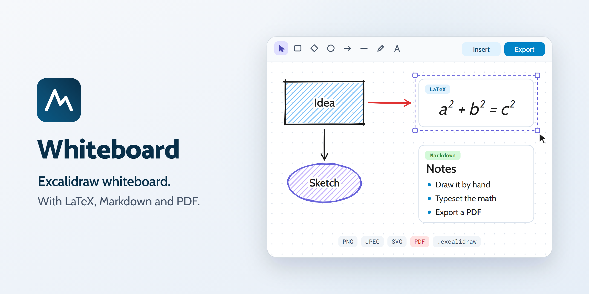

<a href="https://whiteboard.marcopontili.com/">
  <picture>
    <source media="(prefers-color-scheme: dark)" srcset=".github/brand/readme-dark.png">
    
  </picture>
</a>

# Whiteboard

A whiteboard for sketches, formulas, notes, and quick flowcharts. Draw, drop in LaTeX or Markdown, export when done. No account, no upload, works offline. Built on [Excalidraw](https://github.com/excalidraw/excalidraw).

**Live app: [whiteboard.marcopontili.com](https://whiteboard.marcopontili.com/)**

<p align="center">
  
  
</p>

<p align="center">Desktop: sketch, LaTeX, Markdown and Mermaid on one board</p>

<p align="center">
  
  
</p>

<p align="center">Mobile: drawing tools above, Insert and Export below</p>

## How it works

1. Sketch on the [Excalidraw canvas](https://plus.excalidraw.com/how-to-start): shapes, arrows, freehand, text.
2. Use **Insert** for LaTeX formulas, Markdown notes, or Mermaid diagrams when a sketch alone is not enough. Double-click an inserted image to edit its source.
3. Export as PNG, JPEG, SVG, PDF, or `.excalidraw`, or copy the scene to the clipboard.

Boards autosave in the browser. On a phone, Insert, Export, theme and help sit in the bottom bar with 44px touch targets. The app follows your system theme, or pick light or dark from the toolbar.

## What you get

Excalidraw, with these extras on top.

- **LaTeX**: KaTeX formulas placed as sharp images; double-click to edit.
- **Markdown**: sanitized GitHub-flavored notes placed as images; double-click to edit.
- **PDF and JPEG export**, next to PNG, SVG, `.excalidraw` and copy to clipboard.
- **Named boards** saved in the browser, with a warning if storage fills up.
- **Installable app** that opens `.excalidraw` files and accepts shared images and scenes.
- **Agent bridge**: coding agents drive the board through `window.draw` ([docs](docs/agent-surface.md)).

## Privacy

Boards stay in the browser's IndexedDB; nothing is uploaded. Page views are counted with self-hosted, cookieless Matomo that honours Do Not Track; no cookies, no banner. Details: [whiteboard.marcopontili.com/privacy](https://whiteboard.marcopontili.com/privacy).

## Security

KaTeX runs in strict mode with `trust: false`, Markdown goes through DOMPurify, and fonts and assets are self-hosted. Report vulnerabilities as described in [SECURITY.md](./SECURITY.md).

## Built with

| Layer | Stack |
| --- | --- |
| Frontend | React 19, TypeScript, Excalidraw, KaTeX, marked, DOMPurify, jsPDF |
| Framework and build | Vite, vite-plugin-pwa (Workbox) |
| Backend | None: a static single-page app, boards in IndexedDB |
| Server | Apache behind Cloudflare, deployed from GitHub Actions |

## Development

```bash
git clone https://github.com/marcop135/draw.git
cd draw
npm ci
npm run dev        # http://localhost:5173
```

More commands: [docs/commands.md](docs/commands.md).

## Contributing

Read [CONTRIBUTING.md](./CONTRIBUTING.md), then [report a bug](https://github.com/marcop135/draw/issues/new?template=01-bug-report.yml) or [request a feature](https://github.com/marcop135/draw/issues/new?template=02-feature-request.yml).

## Author

[Marco Pontili](https://marcopontili.com)

## License

[MIT](./LICENSE)
